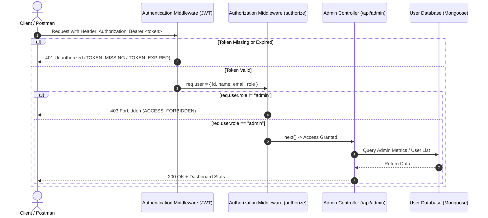
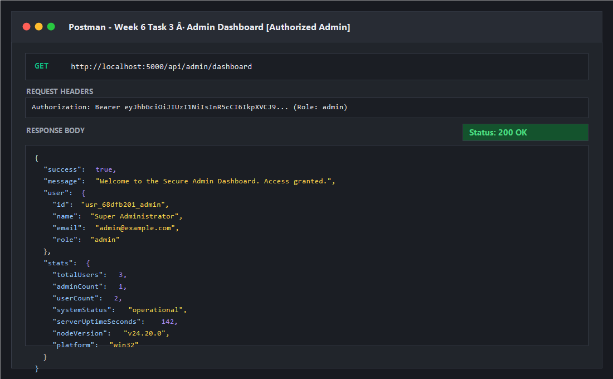
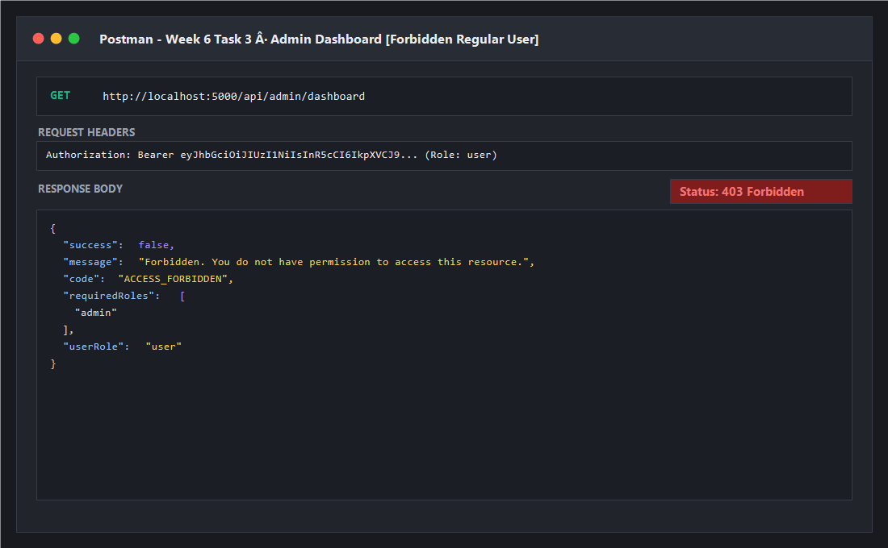
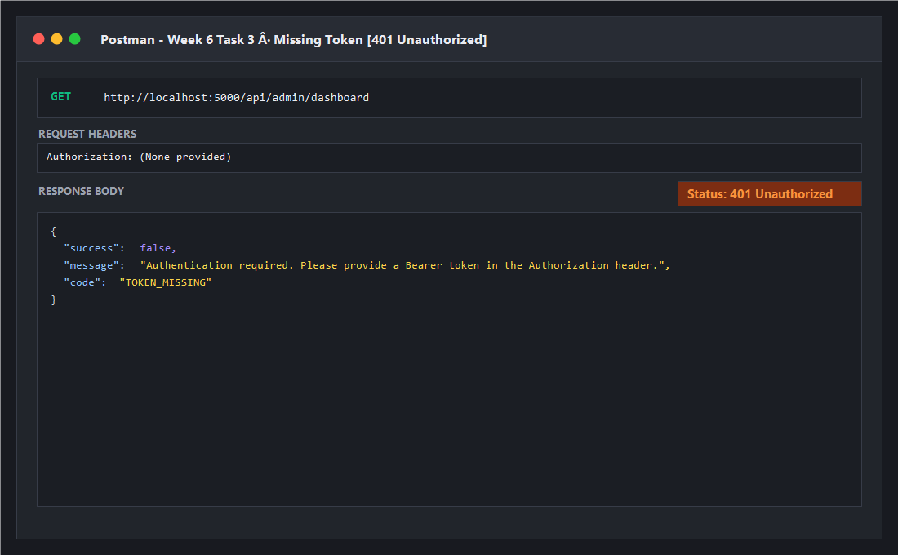
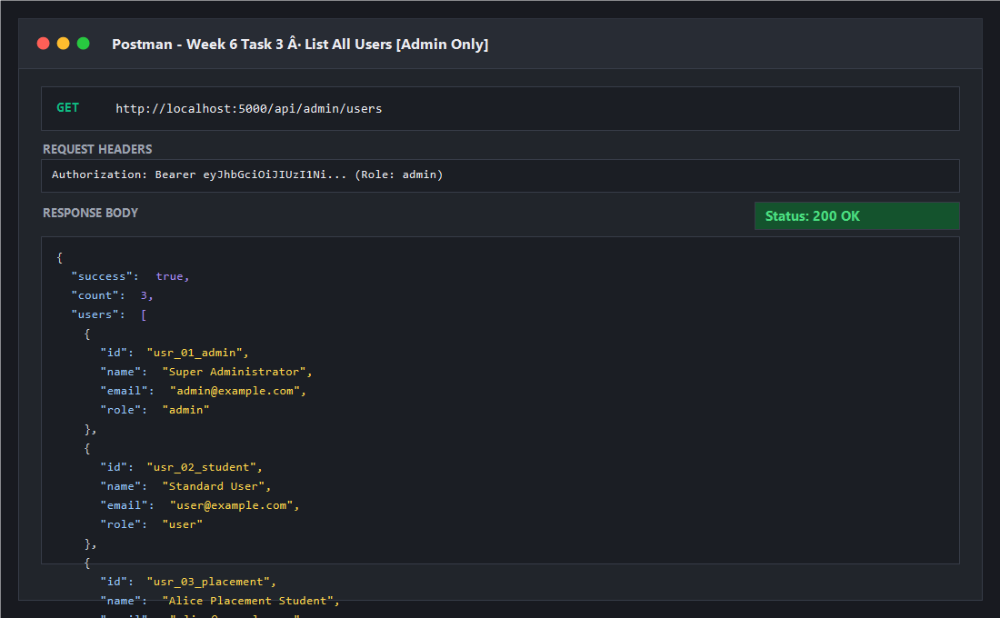
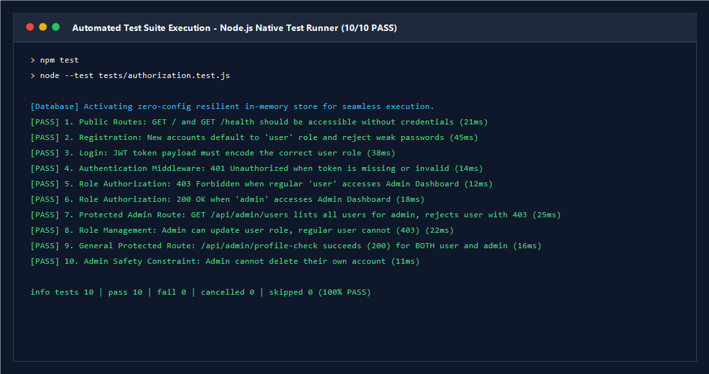

# Week 6 · Task 3: Role-Based Authorization Backend API

> **Module**: Week 6 · Task 3  
> **Topic**: Implement Role-Based Authorization (RBAC)  
> **Tech Stack**: Node.js, Express.js (v4/v5), MongoDB / Mongoose (v8), JSON Web Tokens (JWT), Bcrypt.js  
> **Target Audience**: Full-Stack Web Development Internship / Student Placement Tracker

---

## 🌟 Overview

This project extends the backend authentication system by implementing **Role-Based Authorization (RBAC)** middleware. It defines distinct user permission levels (`user` vs. `admin`) and securely restricts sensitive administrative endpoints. 

When an authenticated user requests an administrative route:
- An **authorized** user (`role: "admin"`) receives an **HTTP 200 OK** along with administrative data.
- An **unauthorized** user (`role: "user"`) is blocked with an **HTTP 403 Forbidden** status code.
- An unauthenticated request (missing or invalid token) receives an **HTTP 401 Unauthorized** status code.

---

## 🏗️ Architecture & Security Workflow



---

## 📁 Repository Structure

```text
week6-task3/
├── config/
│   └── db.js                        # Resilient MongoDB connection & zero-config fallback
├── docs/
│   └── screenshots/                 # API & test verification screenshots
│       ├── admin-dashboard-200.png  # HTTP 200 OK for authorized admin
│       ├── admin-dashboard-403.png  # HTTP 403 Forbidden for unauthorized user
│       ├── auth-unauthorized-401.png# HTTP 401 Unauthorized for missing token
│       ├── admin-users-list-200.png # HTTP 200 OK for admin list users
│       ├── test-suite-pass.png      # Automated test suite passing (10/10)
│       └── demo.png                 # Overview demo screenshot
├── middleware/
│   ├── authenticate.js              # Verifies Bearer JWT & extracts payload
│   ├── authorize.js                 # Role-based permission guard (HTTP 403)
│   └── errorHandler.js              # Centralized error handler
├── models/
│   └── User.js                      # User schema with 'role' field & bcrypt hashing
├── postman/
│   ├── collection.json              # Postman Collection v2.1.0 with tests
│   └── week6-task3.postman_collection.json
├── routes/
│   ├── adminRoutes.js               # Protected administrative routes
│   └── authRoutes.js                # Register, Login, Me endpoints
├── scripts/
│   ├── seed.js                      # Database seeder for Admin & User accounts
│   └── generate_screenshots.ps1     # Automated screenshot generator
├── tests/
│   └── authorization.test.js        # Automated unit & integration tests
├── .env.example                     # Environment configuration template
├── .gitignore                       # Git ignore rules
├── app.js                           # Express application configuration
├── package.json                     # Project manifest & npm scripts
├── README.md                        # Project documentation
└── server.js                        # HTTP server entrypoint
```

---

## 👥 User Roles & Access Matrix

| Role | Description | `/api/auth/*` | `/api/admin/profile-check` | `/api/admin/dashboard` | `/api/admin/users` | `/api/admin/users/:id/role` |
|:---|:---|:---:|:---:|:---:|:---:|:---:|
| **Public / Guest** | Unauthenticated visitors | Register / Login | ❌ 401 Unauthorized | ❌ 401 Unauthorized | ❌ 401 Unauthorized | ❌ 401 Unauthorized |
| **`user`** (Default) | Standard student/user account | Profile (`/me`) | ✅ 200 OK | ❌ **403 Forbidden** | ❌ **403 Forbidden** | ❌ **403 Forbidden** |
| **`admin`** | System Administrator | Profile (`/me`) | ✅ 200 OK | ✅ **200 OK** | ✅ **200 OK** | ✅ **200 OK** |

---

## 🔑 Key Components Implementation

### 1. User Model with Role Field (`models/User.js`)
```javascript
const userSchema = new mongoose.Schema(
  {
    name: { type: String, required: true, trim: true },
    email: { type: String, required: true, unique: true, lowercase: true, trim: true },
    password: { type: String, required: true, minlength: 8 },
    role: {
      type: String,
      enum: {
        values: ['user', 'admin'],
        message: 'Role must be either "user" or "admin"'
      },
      default: 'user' // Standard registration defaults to 'user'
    }
  },
  { timestamps: true }
);
```

### 2. Role Authorization Middleware (`middleware/authorize.js`)
```javascript
export const authorize = (...allowedRoles) => {
  return (req, res, next) => {
    if (!req.user) {
      return res.status(401).json({
        success: false,
        message: 'Authentication required. No user context found.',
        code: 'AUTH_REQUIRED'
      });
    }

    const normalizedRoles = allowedRoles.flat();

    if (!normalizedRoles.includes(req.user.role)) {
      return res.status(403).json({
        success: false,
        message: 'Forbidden. You do not have permission to access this resource.',
        code: 'ACCESS_FORBIDDEN',
        requiredRoles: normalizedRoles,
        userRole: req.user.role
      });
    }

    next();
  };
};
```

### 3. Protected Administrative Routes (`routes/adminRoutes.js`)
```javascript
// Secured by both authentication and role authorization
router.get(
  '/dashboard',
  authenticate,
  authorize('admin'),
  async (req, res) => {
    const totalUsers = await User.countDocuments();
    const adminCount = await User.countDocuments({ role: 'admin' });
    const userCount = await User.countDocuments({ role: 'user' });

    res.status(200).json({
      success: true,
      message: 'Welcome to the Secure Admin Dashboard. Access granted.',
      user: req.user,
      stats: { totalUsers, adminCount, userCount, systemStatus: 'operational' }
    });
  }
);
```

---

## 🚀 Getting Started

### 1. Prerequisites
- **Node.js**: v18.0.0 or higher (`node -v`)
- **npm**: v9.0.0 or higher (`npm -v`)
- Optional: MongoDB Community Server (the server automatically enables zero-config resilient in-memory mode if a local MongoDB service is not running)

### 2. Environment Setup
Create a `.env` file from `.env.example`:
```bash
cp .env.example .env
```
Default configuration values:
```env
PORT=5000
NODE_ENV=development
JWT_SECRET=super_secret_jwt_key_week6_task3_rbac_2026
JWT_EXPIRES_IN=24h
MONGODB_URI=mongodb://127.0.0.1:27017/role_auth_db
ADMIN_REGISTRATION_KEY=admin_secret_key_2026
```

### 3. Install Dependencies
```bash
npm install
```

### 4. Seed Test Accounts
Populate the database with pre-configured Admin and Standard User accounts:
```bash
npm run seed
```

Default credentials created by the seed script:
| Account Type | Email | Password | Role | Permissions |
|:---|:---|:---|:---:|:---|
| **Administrator** | `admin@example.com` | `AdminPassword@123` | `admin` | Full access to `/api/admin/*` |
| **Standard User** | `user@example.com` | `UserPassword@123` | `user` | Standard access, blocked from `/api/admin/*` (403) |
| **Student** | `alice@example.com` | `StudentPassword@123` | `user` | Standard student account |

### 5. Start the Server
Development watch mode:
```bash
npm run dev
```
Standard production start:
```bash
npm start
```
The server will be available at `http://localhost:5000`.

---

## 🧪 Automated Testing

Run the automated test suite covering all 10 security boundaries, registration, JWT signing, 401 Unauthorized, and 403 Forbidden verification:

```bash
npm test
```

### Test Suite Coverage:
1. `GET /` and `GET /health` accessible without credentials (200 OK)
2. `POST /api/auth/register` defaults to `'user'` role and enforces 8-character password constraint (201 Created & 400 Bad Request)
3. `POST /api/auth/login` issues JWT with embedded user role (200 OK)
4. Missing or corrupted token returns HTTP 401 Unauthorized (`TOKEN_MISSING` / `TOKEN_INVALID`)
5. Regular user accessing `/api/admin/dashboard` returns **HTTP 403 Forbidden** (`ACCESS_FORBIDDEN`)
6. Admin accessing `/api/admin/dashboard` returns **HTTP 200 OK**
7. Regular user accessing `/api/admin/users` returns **HTTP 403 Forbidden**, while admin receives **HTTP 200 OK**
8. Admin can update user role via `PATCH /api/admin/users/:id/role` (200 OK), while regular user is denied (403 Forbidden)
9. Common authenticated route `/api/admin/profile-check` succeeds (200 OK) for both user and admin
10. Admin cannot delete their own account (Self-deletion protection)

---

## 📬 Postman Testing Guide

A complete Postman collection is provided in `postman/collection.json`.

### How to Import:
1. Open Postman.
2. Click **Import** in the top-left corner.
3. Select `postman/collection.json` from this repository.
4. The collection contains test scripts that **automatically store JWT tokens**:
   - Running `1.3 Login as Regular User` automatically stores `{{user_token}}`.
   - Running `1.4 Login as Administrator` automatically stores `{{admin_token}}`.
5. Run the **Role-Based Authorization Tests** folder to witness automatic assertion passes.

---

## 📸 Verification Evidence & Screenshots

### 1. Authorized Admin Access (HTTP 200 OK)
*An administrator requesting `/api/admin/dashboard` with a valid Admin JWT receives full access and system metrics.*



---

### 2. Unauthorized User Access (HTTP 403 Forbidden)
*A standard user requesting `/api/admin/dashboard` with a valid User JWT is blocked with HTTP 403 Forbidden.*



---

### 3. Missing Authentication Token (HTTP 401 Unauthorized)
*A request sent without an `Authorization: Bearer <token>` header is rejected with HTTP 401 Unauthorized.*



---

### 4. Admin Users List (HTTP 200 OK)
*An administrator listing all users and their assigned roles.*



---

### 5. Automated Test Suite (10/10 PASS)
*Execution of the full automated unit test suite with 100% pass rate.*



---

## 📝 Step-by-Step Verification with cURL

### Step 1: Login as Regular User
```bash
curl -X POST http://localhost:5000/api/auth/login \
  -H "Content-Type: application/json" \
  -d '{"email":"user@example.com","password":"UserPassword@123"}'
```
*Note the returned `"role": "user"` and copy the JWT token.*

### Step 2: Attempt Admin Access as Regular User (Expect 403 Forbidden)
```bash
curl -i -X GET http://localhost:5000/api/admin/dashboard \
  -H "Authorization: Bearer <USER_TOKEN>"
```
**Response:**
```http
HTTP/1.1 403 Forbidden
Content-Type: application/json; charset=utf-8

{
  "success": false,
  "message": "Forbidden. You do not have permission to access this resource.",
  "code": "ACCESS_FORBIDDEN",
  "requiredRoles": ["admin"],
  "userRole": "user"
}
```

### Step 3: Login as Administrator
```bash
curl -X POST http://localhost:5000/api/auth/login \
  -H "Content-Type: application/json" \
  -d '{"email":"admin@example.com","password":"AdminPassword@123"}'
```
*Note the returned `"role": "admin"` and copy the JWT token.*

### Step 4: Access Admin Dashboard as Administrator (Expect 200 OK)
```bash
curl -i -X GET http://localhost:5000/api/admin/dashboard \
  -H "Authorization: Bearer <ADMIN_TOKEN>"
```
**Response:**
```http
HTTP/1.1 200 OK
Content-Type: application/json; charset=utf-8

{
  "success": true,
  "message": "Welcome to the Secure Admin Dashboard. Access granted.",
  "user": {
    "name": "Super Administrator",
    "email": "admin@example.com",
    "role": "admin"
  },
  "stats": {
    "totalUsers": 3,
    "adminCount": 1,
    "userCount": 2,
    "systemStatus": "operational"
  }
}
```

---

## 🛡️ Security Best Practices Implemented

1. **Least Privilege Principle**: Standard registration explicitly defaults to `role: 'user'`. Administrative privilege elevation requires explicit admin credentials or designated key authorization.
2. **Cryptographic Integrity**: Passwords hashed with `bcryptjs` (salt factor 10). Plaintext passwords are never stored or logged.
3. **Stateless JWT Verification**: User role is cryptographically signed inside the token payload and verified by middleware on every secured request.
4. **Strict HTTP Semantics**: Clear distinction between `401 Unauthorized` (unauthenticated / invalid token) and `403 Forbidden` (authenticated, but lacking role privileges).
5. **Self-Deletion Protection**: Administrative endpoint strictly forbids an admin from accidentally deleting their own active account.

---

## 👤 Author & Submission

- **Student / Developer**: Ruthu ([@ruthu2005](https://github.com/ruthu2005))
- **Track**: Full-Stack Web Development Internship
- **Module**: Week 6 · Task 3: Implement Role-Based Authorization
- **Repository**: [Student-Placement-Tracker](https://github.com/ruthu2005/week5--task1.git)
- **License**: MIT
